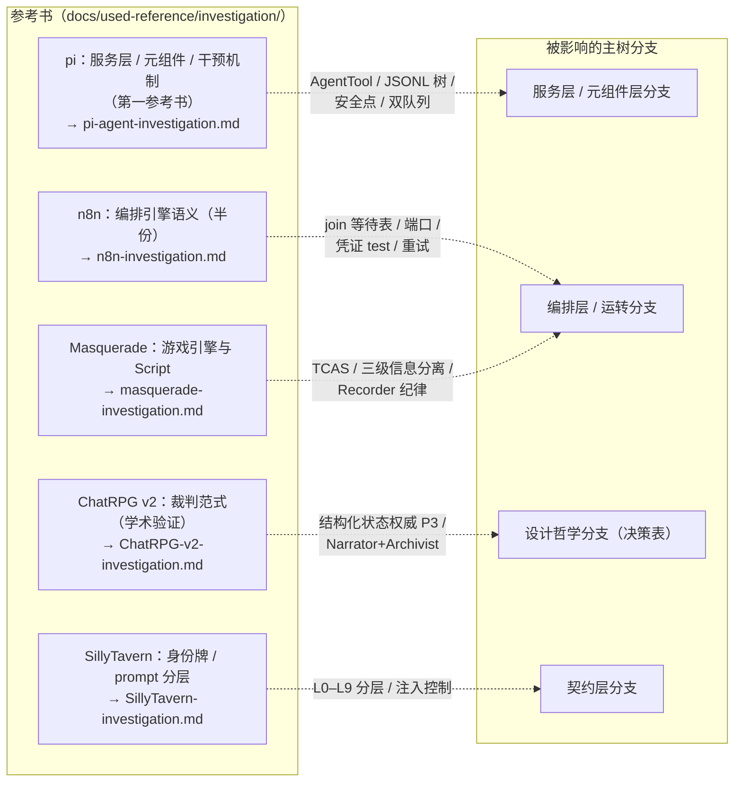

# 设计层级地图（Design Layers）

> **读法**：这是一棵**分解树**——每条边都是"父节点沿某个方向的具体化"（按指导原则拆 / 按存在物拆 / 按运转拆 / 按实现拆）。越靠近根部越抽象（为什么做），越靠近叶部越具体（文档片段）。叶节点深度以"能看见内容"为准，不整齐划一。
>
> **节点格式**：名称 + 指向（`→ 文件 §章节`）+ 管辖该元素的决策（`D#`）。本文档只导航、不承载内容。
>
> **用途**：一眼看见全部设计层次；新元素必须先能挂为某个父节点的子节点，挂不上的不做（core-loop 原则 5 的文档版）。

## 主树

```mermaid
flowchart TD

    ROOT["ThinkingArena<br/>多 LLM 模拟推演 → 事件驱动演绎 → B 站视频<br/>→ docs/Vision.md"]

    ROOT -->|按指导原则拆| PHILO["设计哲学（怎么判断对错）"]
    ROOT -->|按存在物拆| STRUCT["系统组成（静态结构）"]
    ROOT -->|按运转拆| BEHAVE["系统运转（动态行为）"]
    ROOT -->|按实现拆| IMPL["实现与演进（怎么落地）"]

    %% ── 设计哲学 ──
    PHILO --> G3["指导思想 3 条<br/>→ docs/Vision.md"]
    PHILO --> P5["设计原则 5 条<br/>→ docs/core-loop.md §设计原则"]
    PHILO --> FRAME["顶层维度：链 A / 链 B<br/>× 导演操作集 × 不变量<br/>→ docs/design/runtime-architecture.md §0.1"]
    FRAME --> DT["决策表 D1–D37<br/>（逐条标注于下方各元素节点）<br/>→ docs/design/runtime-architecture.md §0"]
    PHILO --> APPX["术语边界 / 分歧与审查记录<br/>→ docs/design/runtime-architecture.md 附录 A / B"]

    %% ── 系统组成 ──
    STRUCT --> M1["M1 模拟核心（自研薄核心）<br/>→ docs/used-reference/architecture.md §2"]
    STRUCT --> OUTER["外围域：M2 复盘 / M3 视频 / M5 回放<br/>→ docs/used-reference/architecture.md §5"]
    STRUCT --> CONTRACTS["契约层（模块间只共享契约）<br/>→ docs/used-reference/architecture.md §3"]
    OUTER --> M4["M4 素材服务（薄封装库，局外被调）<br/>D14 → docs/used-reference/architecture.md §5"]

    M1 -->|core-loop 四层| SVC["服务层（长期子系统）"]
    M1 --> META["元组件层（服务层唯一调用面）"]
    M1 --> COMP["组件层（游戏逻辑最小单元）<br/>接口 §4.7"]
    M1 --> ORCH["编排层（流程的配置化表达）"]

    %% ── 服务层 ──
    SVC --> S1["Agent 服务<br/>接口 §4.1"]
    SVC --> S2["记忆系统<br/>接口 §4.6"]
    SVC --> S3["黑板<br/>接口 §4.2"]
    SVC --> S4["事件流（Script JSONL）<br/>接口 §4.3"]
    SVC --> S5["LLM 网关<br/>接口 §4.4"]

    S1 --> S1A["实例生命周期<br/>状态机 §3.1（六状态 A1–A12）"]
    S1 --> S1B["回合管线 runTurn：组装 → LLM →<br/>工具请求 → 落盘 → 安全点<br/>时序 §2.2 ｜ D3 / D16"]
    S1 --> S1C["干预通道：steering / follow-up 双队列<br/>D4 → 接口 §4.1 steer/followUp"]
    S1 --> S1D["持久化：私有上下文转录（附录 A）<br/>+ 记忆挂载（D22）"]
    S1 --> S1E["上下文渲染：L0–L9 分层 + prompt_hash<br/>→ docs/used-reference/design/overview.md §5.3 ｜ D16"]

    S2 --> S2A["滚动摘要 → L5 投影<br/>接口 §4.6 projection"]
    S2 --> S2B["压缩检查点（自包含，损坏回退上一代）<br/>接口 §4.6 compact ｜ D29"]
    S2 --> S2C["沉淀通道 F17（回合 → 记忆）<br/>D22：无外部写入面"]

    S3 --> S3A["键值写穿（D1）+ 快照（D7）<br/>接口 §4.2 get/set/snapshot"]
    S3 --> S3B["恢复路径 applyEvent<br/>（不写穿/不通知，§4 恢复纪律）"]
    S3 --> S3C["命名空间 + 写者声明（D26）"]
    S3 --> S3D["worldbook 命名空间（世界书，D34）"]

    S4 --> S4A["JSONL 树：parent_id / leaf 派生<br/>接口 §4.3 → pi 调研 §2.3"]
    S4 --> S4B["快照与控制条目（同信封）<br/>D11 / D32"]
    S4 --> S4C["分叉与版本域<br/>D21 / D33 → §2.4"]

    S5 --> S5A["路由 + 同能力级 fallback 链<br/>接口 §4.4 ｜ D13"]
    S5 --> S5B["重试退避 / 熔断（D13 / D28）"]
    S5 --> S5C["价格表 + 缓存断点<br/>D16 / D25 → docs/used-reference/design/overview.md §6.3"]

    %% ── 元组件层 ──
    META --> MC1["AgentTool 式契约：校验前置 /<br/>before-after 钩子 / 错误编码<br/>D5 → 接口 §4.7 ｜ docs/used-reference/design/overview.md §3.2.2"]
    META --> MC2["发射元组件 emit_event（F12）<br/>批内缓冲提交（D9）→ §1.2"]
    META --> MC3["await_director_input（D37）<br/>call_agent / bb_get / bb_set → §4.7"]

    %% ── 组件层 ──
    COMP --> C1["角色创建 / 销毁<br/>→ docs/used-reference/design/overview.md §3.2.3"]
    COMP --> C2["叙事 / 骰子（带种子 RNG）<br/>→ docs/used-reference/design/overview.md §3.2.3"]
    COMP --> C3["判定（Narrator + Archivist 组件组合）<br/>D17 / D26 ｜ 附录 A 裁判同构"]
    COMP --> C4["导演门（分支级输入门）"]
    C4 --> C4A["状态机 §3.2（五态 G1–G8）<br/>时序 §2.1"]
    C4 --> C4B["注入类型封闭集 ×5（D18）<br/>+ 超时策略（D15）"]

    %% ── 编排层 ──
    ORCH --> O1["FlowRunner（DAG 执行器）<br/>接口 §4.5（外观）"]
    O1 --> O1A["状态机 §3.3 + 补充语义<br/>（run 落定 / 组件无状态 / 回边迭代 /<br/>安全点层级 / 恢复纪律）"]
    O1 --> O1B["调度：执行栈 + join 等待表（D8）<br/>TCAS 批协议（D9：快照读+缓冲+分支序提交）"]
    O1 --> O1C["导演指令消费泵（D27/D37）<br/>单门等待约束 + 路由 + 游标落盘"]
    O1 --> O1D["成本闸（D28）<br/>账本 = reducer 累计切片"]
    O1 --> O1E["内部分解：graph / scheduler /<br/>reducer / director-pump / ledger<br/>图校验与冒烟（D20）｜ 节点边界事件（D19/D35）"]

    %% ── 契约层 ──
    CONTRACTS --> K1["事件契约（Script JSONL）<br/>必需事件族 + 类型空间<br/>D31 / D32 → docs/used-reference/architecture.md §3"]
    CONTRACTS --> K2["流程图配置（封闭算子条件 DSL，D7）<br/>→ docs/used-reference/architecture.md §3"]
    CONTRACTS --> K3["元组件接口<br/>→ docs/used-reference/architecture.md §3"]
    CONTRACTS --> K4["identity_card_v1（身份牌）<br/>→ docs/used-reference/design/overview.md §5.3 / §7.5"]
    CONTRACTS --> K5["Scenario Bundle / run manifest<br/>D24 / D33 → docs/used-reference/architecture.md §3"]
    K5 --> K5A["场景实例：异世界生存 Odyssey<br/>→ docs/scenarios/isekai-survival.md"]

    %% ── 系统运转 ──
    BEHAVE --> B1["数据流 F1–F18（F11 已删）<br/>→ docs/design/runtime-architecture.md §1"]
    BEHAVE --> B2["关键时序 ×4：导演门 §2.1 /<br/>单回合 §2.2 / 崩溃恢复 §2.3 /<br/>改版分叉 §2.4（D21）"]
    BEHAVE --> B3["错误处理矩阵<br/>→ docs/design/runtime-architecture.md §5"]

    %% ── 实现与演进 ──
    IMPL --> I1["目录结构：schema / services / meta /<br/>components / orchestrator / cli<br/>→ docs/used-reference/architecture.md §2"]
    IMPL --> I2["技术栈：TS/Node · ai SDK · zod · yaml<br/>· node:sqlite · edge-tts · Remotion<br/>→ docs/used-reference/research.md §7/§8"]
    IMPL --> I3["演进路径：Phase 0–5 + MVP 分期<br/>→ docs/roadmap.md ｜ §0.2"]
    I1 --> I1A["CLI 导演界面：F15 控制 / F16 观察<br/>观察者纪律 D10 → §1.2"]

    %% ── 跨枝约束（虚线，非父子）──
    B1 -. 约束落实 .-> SVC
    B3 -. 错误枚举即接口输入 .-> O1
```

## 溯源：知识嫁接（非系统组成，仅标注各分支判断的出处）

## 决策覆盖索引（D1–D37 全挂点）

| 决策 | 挂点节点 | 决策 | 挂点节点 |
|------|---------|------|---------|
| D1 黑板写穿 | S3A | D18 干预封闭集/note | C4B |
| D2 无直发通道 | S1 / MC1 | D19 节点边界事件 | O1E |
| D3 安全点 | S1B | D20 加载期校验 | O1E |
| D4 双队列 | S1C | D21 版本域 | S4C / B2 |
| D5 错误编码进结果 | MC1 | D22 持久化边界 | S1D / S2C |
| D6 截断整批拒执行 | S5B | D23 一局一进程 | O1A |
| D7 封闭算子/快照 | S3A | D24 作品库 | K5 |
| D8 join 等待表 | O1B | D25 否决响应缓存 | S5C |
| D9 TCAS 批协议 | O1B | D26 命名空间写者 | S3C / C3 |
| D10 观察者纪律 | I1A | D27 消费泵 | O1C |
| D11 内联快照 | S4B | D28 成本闸 | O1D / S5B |
| D12 恢复点语义 | S4C | D29 文件并发协议 | S2B / K5 |
| D13 重试/fallback/熔断 | S5A/S5B | D30 修剪占位 | I3 |
| D14 素材局外 | M4 | D31 下游内容契约 | K1 |
| D15 门超时策略 | C4B | D32 事件类型空间 | K1 / S4B |
| D16 成本双轨/hash | S1B/S1E/S5C | D33 版本身份 | S4C / K5 |
| D17 判定重试升级 | C3 | D34 世界书归属 | S3D |
| D35 事件唯一写者表 | K1 / MC2 / O1E | D36 孤儿事件规则 | S4C / O1A |
| D37 导演门本体 | C4 / MC3 / O1C | | |

## 维护纪律

- 本文档只导航、不承载内容；任何节点内容变更只改载体文档，本文档随之更新指针与覆盖索引。
- 新增设计元素必须能作为**某个父节点沿明确方向的子节点**挂上树（并写明分解方向）；挂不上的，回到"设计哲学"分支讨论它是否配存在。
- 分解方向单向向下：上层约束下层，下层不得反向定义上层（实现选型不改变意图与领域模型）。
- 跨枝引用（运转 ⇄ 组成）只允许虚线标注"约束落实"，不构成父子关系。
- 新决策必须在"决策覆盖索引"登记挂点；没有挂点的决策是孤儿，没有决策的叶子是黑盒——两者都不允许存在。
