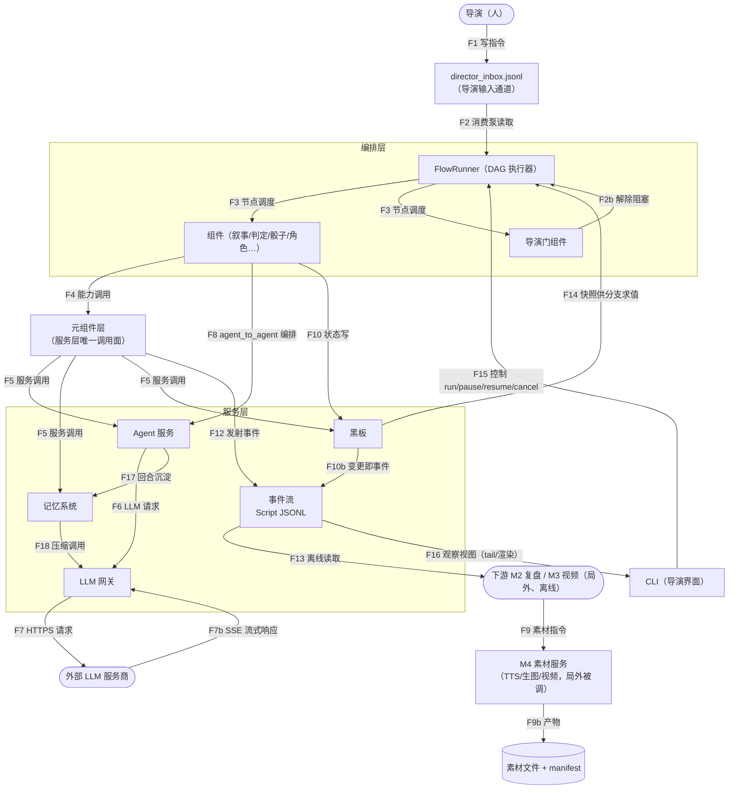
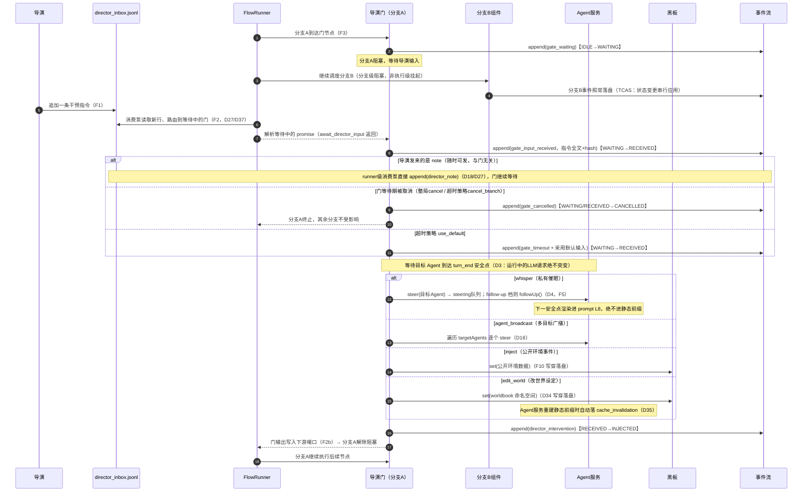
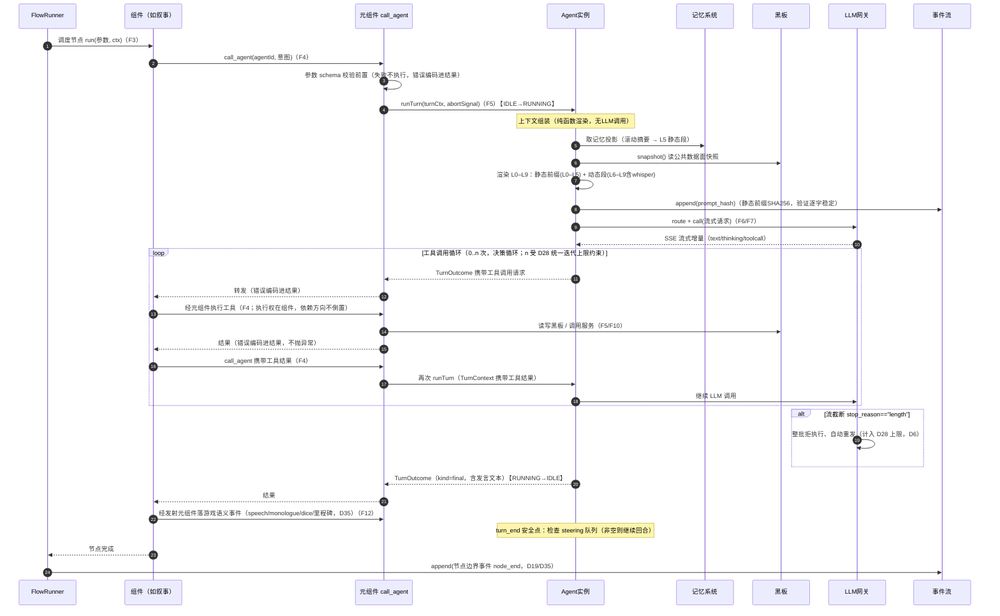
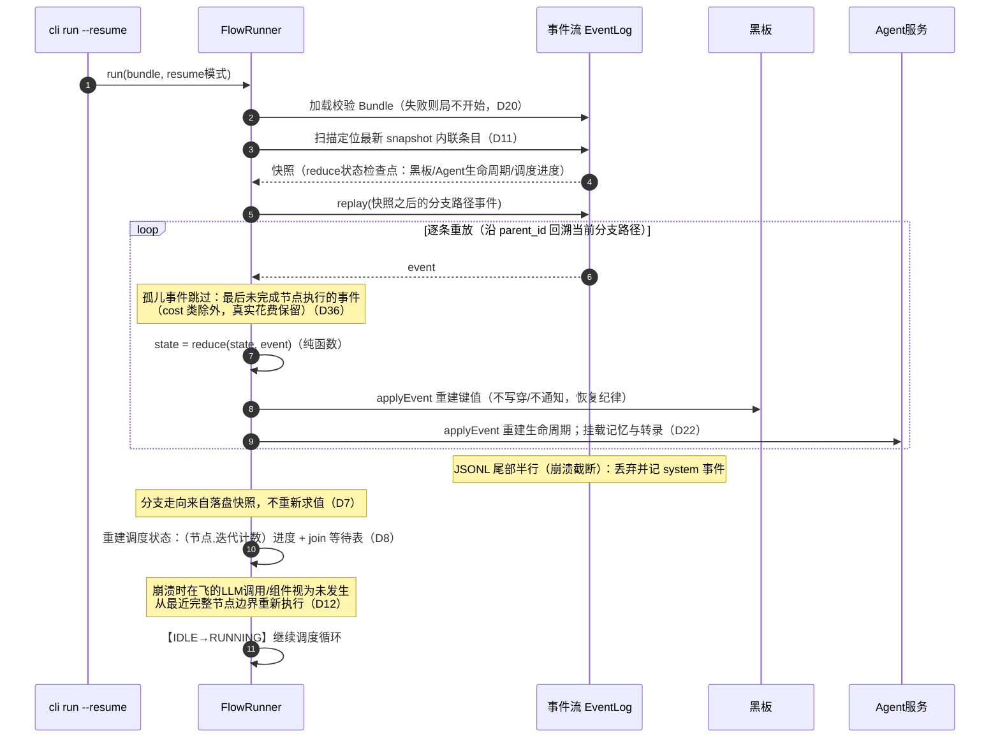
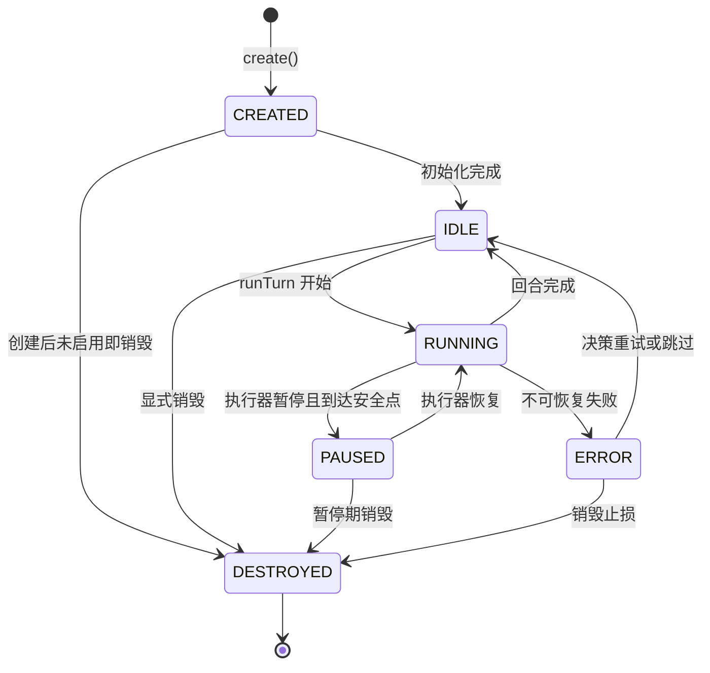
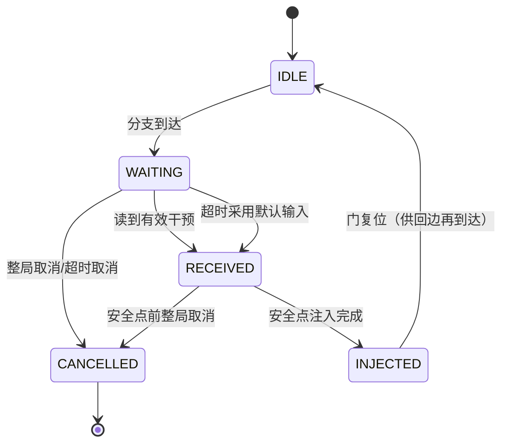
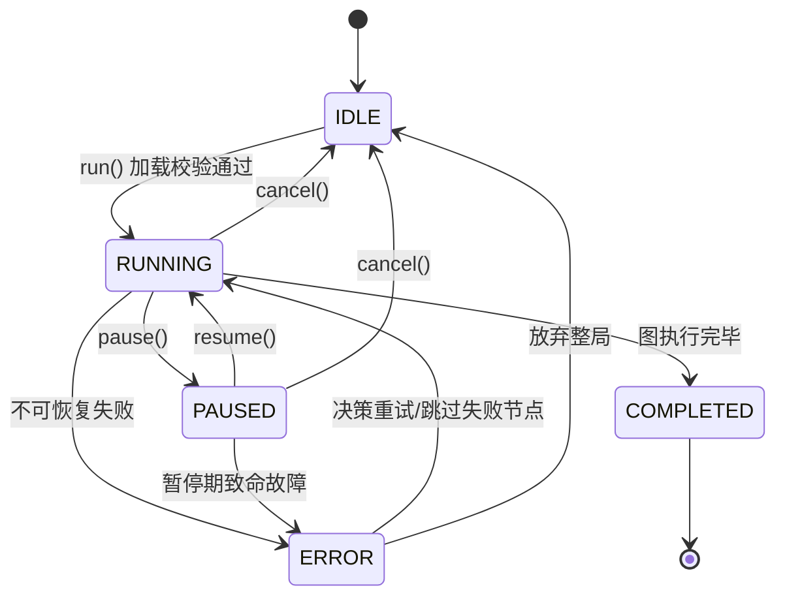

# 运转架构文档（Runtime Architecture）

> **文档定位**：本文档是 ThinkingArena **运转架构的权威定义**——系统运行时的数据流、时序、状态机、模块接口与错误处理唯一定义于此。
>
> **与既有文档的关系**：`docs/Vision.md` 是项目意图的唯一权威来源；`docs/used-reference/`（architecture.md、design/overview.md、investigation/* 等）均为**调研与素材**，不是权威设计。本文档在调研素材之上独立推理而成；凡与调研文档冲突之处，以本文档为准，分歧记录见附录 B。
>
> **纪律**：每个设计决策标注来源（调研出处或"自推理"+理由）；不定义具体字段（留给 Schema Agent，文中类型名为契约占位）；不写实现代码（接口仅签名）；不引入新框架或库。
>
> **版本**：v1.0 | **日期**：2026-07-24

---

## 0. 设计决策总表（含来源标注）

### 0.1 顶层维度：本系统的产出物是"内容"，不是"执行"

本文档的设计起点不是引擎机制，而是 Vision 定义的产出链：**导演迭代的是作品版本，不是进程状态**。系统内有两条生命周期：

- **链 A · 内容生命周期**（一次生产）：Bundle（剧本配置）→ 局 → Script（叙事事实 + 证据）→ 分支族谱（版本谱系）→ 下游加工（复盘/分镜/成片）。
- **链 B · 长期存续实体**（跨局积累）：Agent 记忆（跨局存续）、作品库（N 局 × M 版的 Script 与产物集合）、成本台账（跨局汇总）、素材文件（磁盘积累）。它们不在一次生产的链条上，有自己的诞生/积累/检索/修剪问题。

**导演操作集**（对内容的操作，而非对进程的操作）：创作配置、开局、观察、局中注入、局间改版再开、版本对比、挑选高光、废弃分支、检索/管理已有作品（找回、归档）、批量/无人值守运行（锦标赛）。

**不变量**：链 A——可归因（每个产物能回答"哪版配置、哪次干预产生了它"）、可重放（确定性）、可对比（版本并列）；链 B——记忆可审计可修剪、库可检索、账可汇总；全局——成本可账。

低层机制（数据流/状态机/接口）必须能回挂到这两条链与操作集，回挂不了的不做——core-loop 原则 5 的运转版。**反例**：为"改图后部分复用旧执行结果"引入 stale 传播优化，就是把算力复用置于作品版本归因之上的类别错误（见 §2.4 的被否决方案）。

| # | 决策 | 来源 / 推理依据 |
|---|------|----------------|
| D1 | **黑板写穿事件流**：`set` 先落盘为事件、后生效，黑板状态可由事件流完整重建 | 自推理。若黑板允许绕过事件流的直接写，则"崩溃恢复 = 重放 JSONL"无法恢复黑板，产生第二真相源——与 n8n 调研排除"执行级挂起恢复"的理由（双真相源）同构。机制基础：pi 的 JSONL 树 append-only（`session-manager.ts`）+ 事件溯源 `state = reduce(state, event)` |
| D2 | **Agent 间无自主直发通道**：一切"Agent 对 Agent"通信由组件编排，经元组件注入目标 Agent 私有上下文，并以 `agent_to_agent` 事件落盘 | 自推理。若服务层提供 broadcast/sendTo，Agent 可在编排层之外互相驱动，绕过导演门与安全点机制，违背"显式优于自动"（core-loop 设计原则 2）与 12-Factor Agents 的 Own your control flow。信息可见性纪律参考 Masquerade 三级信息分离（public/private/role_info，`engine/base.py`）。**此决策修正 pi 调研 §6.2.1 的 AgentService.broadcast/sendTo 提案** |
| D3 | 干预只在循环安全点生效，运行中的 LLM 请求/组件执行绝不突变 | pi 的 Turn 快照 + 安全点（`packages/agent/src/agent-loop.ts`，pi 调研 §3.4） |
| D4 | 导演干预两档：steering（tool 边界打断转向）/ follow-up（自然停止点续作） | pi 的 Steering/Follow-up 双队列（`packages/agent/src/agent.ts`，pi 调研 §3.5） |
| D5 | 跨模块错误编码进返回值（`Result<T, 错误枚举>`），不抛裸 `Error`；错误类型全部枚举化 | pi 的 AgentTool 契约"错误编码进结果，不抛异常"（pi 调研 §3.1）；枚举化是本文档验收要求，也是唯一开发者可审计的前提 |
| D6 | `stop_reason=="length"`（流截断）整批拒执行并告知重发 | pi 的 AgentTool 约束（pi 调研 §3.1），防止部分工具执行导致状态不一致 |
| D7 | 分支条件在遍历瞬间求值，读到的黑板快照作为事件落盘；重放时分支走向来自记录而非重新求值。算子集为**封闭最小集**（比较/布尔，清单留 Schema Agent），快照落**被引用键子集**而非全量 | overview §5.1；机制源自 pi JSONL 树调研 §3.2。重放确定性的刚需；封闭算子是 D20 可校验性的前提（契约审查） |
| D8 | 编排调度 = 执行栈 + 显式 join 等待表 + join 超时 | n8n 的 `waitingExecution`/`waitingExecutionSource` 与 `requiredInputs`（n8n 调研 §4.3、模式卡片 A3）；join 超时作为死锁缓解（pi 调研 §6.3 风险表） |
| D9 | 并行分支遵守 **TCAS 批协议**：FlowRunner 在批前取统一黑板快照 → 批内组件以"快照 ⊕ 本分支缓冲"为视图并发思考 → 发射事件按分支缓冲 → 批结束按声明分支序串行提交（append + apply） | Masquerade 的 Think-Concurrent-Apply-Serial（`orchestrator/runner.py:_process_batch`，Masquerade 调研 §4.4）。可实现性裁决：写穿即时生效（D1）+ 组件中途发射会让"串行应用"无处寄生——缓冲是批作用域的两阶段发射，批外行为不变。跨批事件交错序不可复现，确定性只对回放成立（§2.4-6） |
| D10 | **观察者纪律**：局外/长驻观察者（CLI 视图等）的故障不影响局内。**Blackboard 的 emit/subscribe 已删除**——无消费者：门经 `await_director_input` 等待（D37）、CLI 经 F16 tail、记忆经 F17 推送；瞬态旁路通道由此消失 | Masquerade 的 Recorder 被动观察者纪律（调研 §7.3）。删除依据：实现审查确认三个名义订阅者都有更窄的通道，订阅机制是 D2 否决的旁路的同构物 |
| D11 | 快照以**内联条目**写在 Script JSONL 中（非独立文件），非破坏性 | pi 的 CompactionEntry（`session-manager.ts`，pi 调研 §2.3/§3.2）：压缩检查点自包含、append-only 纪律不被第二个文件破坏 |
| D12 | 崩溃恢复点 = 最近一个完整落盘的节点边界；崩溃时在飞的 LLM 调用/组件作废，恢复后重新执行 | 自推理（事件溯源标准语义：已落盘的是事实，未落盘的从未发生）+ n8n 模式卡片 A5 节点执行快照提供节点边界粒度 |
| D13 | LLM 失败处理 = 可重试类型判定 + 指数退避 + 同能力级 fallback + 熔断计数 | n8n 的 `retryOnFail`/`maxTries`（n8n 调研 §4.5，借鉴并增强"区分可重试错误类型"）+ overview §6.3 自研薄路由 |
| D14 | 素材服务调用（TTS/生图/视频）失败可降级跳过该素材，**不阻断管线产出**；素材调用归局外管线，局内组件不调用 | 自推理。素材产物不进入状态权威（结构化状态唯一权威防吃书，ChatRPG v2 的 P3 模式），缺失只影响单条素材，不应让整条视频管线陪葬；局内不调用是 core-loop 产出管线定位（加工者在局外）的直接推论 |
| D15 | 导演门声明超时策略（wait_forever / use_default / cancel_branch） | 自推理。isekai-survival §1 规划的锦标赛模式是无人值守批量跑局，无限等待不可接受；默认 wait_forever 保持 MVP 交互式导演语义 |
| D16 | 每次 LLM 调用落 cost 事件（价格表计算值 + 原始 usage 双轨）；每回合静态前缀 SHA256 落 Script | overview §5.3 成本双轨台账与逐字稳定验证 |
| D17 | 裁判判定输出 schema 校验失败：重试（记 `judge_retry`），达上限后升级导演裁决 | overview §5.4 降级路径；升级导演是"显式优于自动"的必然推论——系统不替导演做裁决 |
| D18 | `note` 类导演指令随时可发、仅批注 Script，不解除任何阻塞；由 runner 级消费泵直接落盘（D27），不需要门在等待。所有导演指令落盘携带**指令全文**（hash 作校验），干预类型为封闭集合：whisper / inject / edit_world / note / agent_broadcast（多目标 steering） | overview §5.2 注入类型表；全文落盘是"可归因"不变量的要求（下游审查：只落 hash 则干预内容必须反查 inbox，而 inbox 不是交付物） |
| D19 | 节点执行边界（开始/结束/失败）落盘为事件 | n8n 模式卡片 A5 节点执行快照（`ITaskData`），改造为 Step 级事件而非 item 级血缘（排除 pairedItem，n8n 调研 E1） |
| D20 | Bundle 加载期完成图校验与 LLM 绑定冒烟，失败则局不开始 | n8n 模式卡片 A6 凭证声明与测试（`ICredentialTestFunction`）；把配置类错误消灭在运转之前 |
| D21 | **版本域语义（fork 模型）**：Bundle 版本是分支的身份属性——内容只在其产生的版本内可用；改版 = 开新局新分支，旧分支封存只读、可在旧版本下回放/重跑/对比；同版本内可从任意事件分叉重跑 | 自推理（顶层维度：导演迭代的是作品版本而非进程状态，见 §0.1）+ pi 的 /fork 分叉与 leaf 指针（pi 调研 §2.3）。明确否决 n8n 式 stale 传播（跨版本部分复用）：它用可观的实现复杂度换算力节省，却模糊"这段叙事是哪版规则产生的"——对本项目，可归因性高于算力。版本身份的构成见 D33 |
| D22 | **服务层持久化边界**：事件流内状态（黑板、Agent 生命周期、调度进度）可重放重建；Agent 记忆与私有上下文转录在事件流**之外**独立持久化（压缩检查点自包含），进程退出后存续、跨局显式挂载（Bundle 声明 agentId → 记忆文件引用）；记忆写入由服务内部从回合沉淀（无外部写入面）；`destroy` = 持久化后解除自动挂载，记忆文件保留供显式引用 | core-loop"记忆系统独立持久化" + pi CompactionEntry 自包含检查点（pi 调研 §2.3）。裁决 §2.3 与附录 A 的表述矛盾：记忆不从事件流重建，崩溃恢复重建的是记忆挂载点引用。私有上下文转录同走此通道（实现者/简化者审查：私有数据不进黑板——D2 信息分离的机制保证） |
| D23 | **运行形态：一局一进程**；多局并行（锦标赛）= 多进程，由外部脚本/Agent 工具编排；AgentService、黑板、网关熔断的作用域均为进程内；跨局共享只有文件系统（作品库 + 记忆文件） | 自推理。规模纪律与 12-Factor：单进程无跨进程协调、失败隔离天然；isekai §1 锦标赛是 MVP 后首个扩展，此决策反向约束接口作用域，必须现在定 |
| D24 | **作品库约定**：一局一个目录（命名含场景/日期/Build 标识）= Script + run manifest + products/（下游产物落点）；manifest 含 Bundle 版本 hash（D33）、Bundle 指针、结局、成本汇总、族谱指针（跨版本 = 新局新文件，manifest 记录源局与源事件 id）；manifest 在 run 落定（COMPLETED/cancel）时写，进入 ERROR 挂起时也写一份（标记 error），恢复后幂等重写；manifest 是 Script 的派生物，缺失可由 CLI 重扫补写；跨局成本聚合 = 扫描 manifest，属 CLI/下游职责 | 链 B 的"库可检索、账可汇总"不变量；"找回某局 / 版本对比"必须有文件层落点；manifest 可重建性解决"局成而 manifest 未写"的断电窗口（故障/契约审查）；写入时机对齐 §3.3"ERROR 为挂起态"（外部审查） |
| D25 | **否决响应级 LLM 缓存**：网关的"缓存"仅指服务商原生缓存管理（D16 已覆盖）；不做请求指纹→响应缓存 | 自推理。版本域语义（D21）的推论：每一局/每一分支必须是真实发生的生产，缓存命中会把"新生产"偷换成"旧回放"；锦标赛各 Build 身份牌不同、前缀本就不同，缓存命中率低 |
| D26 | **黑板键命名空间 + 写者声明**：组件在 description 声明可写键前缀（如状态表键仅裁判组件可写），加载期校验（D20 的延伸）；运行期越权写 = 节点失败走 onError | 防吃书的机制化："Archivist 是状态变更唯一发起者"不能靠图作者自律；ChatRPG v2 的 P3 结构化状态权威 |
| D27 | **导演指令消费泵与路由**：inbox 有常驻消费方（runner 级），note 类指令到达即直接落盘（不需门等待）；门指令按目标标识路由到等待中的门；MVP 约束同一时刻最多一门 WAITING（D20 加载期校验）；inbox 消费游标随状态事件落盘（崩溃恢复不重读） | 自推理。实现者审查：D18 说 note 不经门，但 inbox 唯一消费方是门——无门等待时 note 无人落盘，D17 导演裁决也无返回通道。单门约束是规模纪律下的路由简化 |
| D28 | **成本闸**：局级成本预算阈值（Bundle/CLI 配置），累计超阈 → 局暂停并通知导演；工具循环、截断重发、`judge_retry` 共享统一迭代上限。**账本归属**：cost 事件经 reduce 累计，账本是 FlowRunner 调度状态的派生切片（无独立台账子系统） | 自推理。故障审查：D16 只有"账"没有"闸"——无人值守锦标赛下，0..n 工具循环 + 重试叠加 N 进程，账单失控是迟早路径。类比 D13 熔断计数，作执行器兜底而非图作者自律 |
| D29 | **文件层并发与损坏约定**：run 目录以 run id 唯一命名；run manifest 临时文件 + rename 原子写；记忆文件单写者（同一记忆同时只被一个进程挂载，挂载冲突报错）；压缩检查点损坏回退上一代（非破坏性压缩的必然产物） | 故障审查。D23"跨局共享只有文件系统"必须配文件级协议，否则锦标赛 N 进程写库与双进程挂同一记忆都是未定义竞态 |
| D30 | **链 B 修剪策略（占位）**：作品库修剪 = 导演显式归档/废弃（CLI 操作、文件移动），系统永不自动删除；快照写入频率 = 周期性节点边界 + 局末 + pause 时 | 故障审查。§0.1 链 B 自己点名"修剪问题"但无决策，空头支票转为显式欠债；永久保留是默认，删除永远是导演显式行为（显式优于自动） |
| D31 | **下游内容契约（必需事件族）**：发言/独白（全文 + 角色归属；monologue 语义含 LLM reasoning/thinking 全文——"内心独白"即视频素材）、判定（档级 + 修正明细）、状态变更（数值依据，isekai §2 要求）、干预（**指令全文** + hash 校验）、里程碑（幕/世界/回合边界，语义坐标与图结构解耦）、成本（原始 usage + 时间）；事件信封必带墙钟时间戳 | 下游审查。§0.1 宣告"可归因/可对比"，但支撑它们的语义信息曾被整体下放给 Schema 阶段——事件族与最小语义载荷是架构级承诺（字段细节仍留 Schema Agent）。干预只落 hash 与可归因直接冲突："导演如何操纵故事"本身就是视频素材（overview §5.2） |
| D32 | **事件类型空间结构**：内核封闭集（本文档已命名的 run_*/gate_*/agent_*/cost/prompt_hash 等）+ 组件自定义开放集（命名空间前缀约定，校验器按注册表校验）；快照/fork 等控制条目与叙事事件同一信封、不同 type | 契约审查。F12 承诺"schema 校验前置"，则类型空间的开放方式本身是架构承诺；组件事件（如骰点）必须有合法注册路径 |
| D33 | **版本域身份 = Bundle 全输入 hash**：图、组件版本、身份牌、LLM 绑定、世界书、**种子**全部参与；`run_started` 记录该 hash，恢复校验比对它。种子参与版本身份的推论：同版本 rerun 复现骰点序列（天然控制变量对照）；改种子即改版、开新分支 | 契约审查。只 hash 图 YAML 会让"改身份牌/世界书后 resume 旧局"通过校验——正是 D21 要消灭的版本混淆且不可检测。core-loop 明确种子属 Bundle，本文档此前漏了它 |
| D34 | **世界书归属**：运行时可写副本放黑板 `worldbook` 保留命名空间（加载期从 Bundle 导入；写者仅导演门组件，D26）；edit_world = 写穿该命名空间 + `cache_invalidation`，下次上下文组装重建 L3 静态段 | 自推理（分解树暴露的归属空洞：G5 的 edit_world 目标物无层可归）。世界书是 L3 静态前缀来源（overview §5.3），放黑板公共命名空间使注入、缓存失效、写者校验全部复用既有机制，零新增子系统 |
| D35 | **事件族唯一写者表**：编排事实（`run_*`/`node_*`/join/控制条目/`director_note`）→ FlowRunner；服务事实（cost/prompt_hash/`cache_invalidation`——服务在重建静态前缀时自动落，含 edit_world 触发/`agent_*`/`turn_*`）→ 服务自动落；游戏语义（speech/monologue/dice/里程碑/`agent_to_agent`/`gate_*`/`director_intervention`）→ 组件显式发射（speech 由 `TurnOutcome` 带回组件后发射，不由 Agent 实例中途落） | 可实现性审查：F12 分工与 §2.2 时序三处打架（speech/节点边界两属），六类写者无所有权表必然双写或漏写。节点边界是调度事实，只能由 FlowRunner 落（组件自行落会在失败/取消路径漏落） |
| D36 | **节点执行标识与孤儿事件规则**：事件信封从第一天携带节点执行标识（节点 id + 迭代计数，字段留 Schema Agent）；崩溃恢复时，最后一个未完成节点执行已落的事件视为孤儿——重放跳过（**cost 类除外**，真实花费不作废）；重跑该节点时重新落盘；导演门重入时先查已落盘的 `gate_input_received`，有则直接进入 RECEIVED 而非重新等待 | 实现沙盘：在飞节点崩溃前已写穿/发射的事件在 append-only 下无法"作废"，不处理则重跑产生重复发言/重复状态变更；信封不带执行标识则是事后无法补救的破坏性变更 |
| D37 | **导演门本体**：门 = 普通无状态组件，run 内经 `await_director_input` 元组件等待；inbox 消费泵 = orchestrator 内部模块（非服务、非组件），路由指令并解析等待中的 promise；门不是订阅者。单门等待（D27）加运行期兜底：第二门进入 WAITING → 节点失败走 onError | 实现审查：门"既是无状态组件又是长驻订阅者"自相矛盾；泵归 runner 则门需要经元组件触达泵的通道。等待只是栈上 pending promise，持久状态全在事件流——无状态组件与 wait_forever 长等待不冲突 |

### 0.2 MVP 范围与分期（规模纪律）

决策平权 ≠ 同期实现。规模审查警告：37 条决策全量实现的框架侧估算已超"几千行"纪律，必须分期——**语义先行、实现分期**（本表承诺的是行为，不是当期代码量）：

- **首局验证（线性图即可）**：D1–D7、D12、D16–D20、D22–D24、D27、D28（最小实现：成本累计 + 阈值可设极大值，机制必须在场）、D31–D34；调度器只做线性 + 回边 + 条件分支，门即全局暂停点；图中不得有两个可能同时到达的门节点（D27，Phase 1 解除）。
- **多人游戏（roadmap Phase 1《谁是卧底》起）**：D8–D9（并行分支/join/TCAS 批协议）、D11、D13–D15、D29–D30 生效。
- **锦标赛 / AI 生成组件前**：D26 运行期校验、D21 的 fork 入口可随后到，但语义已定、不返工。
- **不分期**（任务书既定）：崩溃恢复（§2.3）、分支级导演门阻塞、steering/follow-up 双档。

---

## 1. 数据流图

### 1.1 总图



### 1.2 数据流明细表（每条流：格式 / 同步性 / 错误时行为 / 是否落盘）

> "落盘"指是否作为事件写入 Script JSONL。进程内调用的"格式"指跨边界的载荷形态。

| # | 数据流 | 格式 | 同步性 | 错误时行为 | 落盘 | 依据 |
|---|--------|------|--------|-----------|------|------|
| F1 | 导演 → `director_inbox.jsonl` | JSONL（每行一条导演指令） | async（人随时写） | 无效行：跳过 + CLI 告警 + 记 system 事件；不阻断 | 有效输入落盘携带**指令全文** + hash（D18/D31）；无效行记 system 事件 | overview §5.2 输入通道 MVP；D18、D27 |
| F2 | inbox → 消费泵（orchestrator 内部）→ 路由 | JSON 行 | async（泵常驻读取；note 直落盘，门指令解析等待中的 promise，D27/D37） | 无效行按 F1 处理；无门等待时的门指令：MVP 拒绝并通知导演（不缓冲，显式优于自动） | note 记 `director_note`；门指令记 `gate_input_received` | D27、D37 |
| F2b | 导演门 → FlowRunner（解除阻塞） | 进程内信号（门节点输出到下游端口） | sync | 注入目标已销毁：干预降级为 note（仅批注）并通知导演 | `director_intervention` | 自推理：目标不存在时静默丢弃不可归因，降级 note 保住"一切可归因" |
| F3 | FlowRunner → 组件（节点调度） | 进程内调用，参数为 JSON（Zod 校验） | async（组件 run 是异步函数；调度本身串行 await） | 参数校验失败属配置错误，加载期拦截（D20）；运行期组件失败按节点 onError 策略（stop/retry/continue） | 节点边界事件（开始/结束/失败） | n8n A5、R4；D19 |
| F4 | 组件 → 元组件 | 进程内调用，参数 JSON | async | schema 校验前置，失败不执行；before 钩子可拦截（钩子属元组件契约，挂载于元组件声明，pi AgentTool 参照）；错误编码进结果返回组件，不抛异常 | 否（元组件调用本身不落盘；调用失败经节点失败事件由 FlowRunner 落，D35；游戏语义事件由组件经 F12 显式发射） | pi AgentTool 契约；D5 |
| F5 | 元组件 → 服务层各服务 | 进程内调用 | async（Agent 服务/记忆/LLM 网关）；sync（黑板 get/set、事件流 append） | 各服务返回 `Result<_, 错误枚举>`；事件流 append 失败为致命错误 → 终止局 | 视调用类型落对应事件 | D1、D5 |
| F6 | Agent 服务 → LLM 网关 | 进程内调用，请求为 JSON（含 L0–L9 渲染产物） | async | 见 D13：退避重试 → 同能力级 fallback → 熔断 → 编码进结果 | 每调用落 cost 事件 + 静态前缀 SHA256 | D16；pi 两段式接缝（存储全集 ⊃ 进模型投影） |
| F7/F7b | LLM 网关 ↔ 服务商 | HTTPS 请求 JSON；响应 SSE 流 | async（流式） | 超时/限流/5xx 走 D13；流中断或 `stop_reason=="length"` 整批拒执行并重发（D6）；AUTH/QUOTA 不重试直接 fallback；**错误事件只记枚举与元数据，原始响应体不进 Script**（防凭证随错误载荷落盘） | 失败与重试落事件；成本落 cost | D6、D13；故障审查（凭证消毒） |
| F8 | Agent 间通信（`agent_to_agent`） | 进程内：源 Agent 输出文本经组件编排，注入目标 Agent 私有上下文 | sync（在组件 run 内顺序完成） | 目标 Agent 不存在/已销毁：错误编码进结果返回组件；注入失败不半成品落盘 | 是，`agent_to_agent` 事件（source/target），由组件发射（D35） | D2；Masquerade 三级信息分离。图中组件→服务直边均为**经元组件的简写**（组件不持有服务句柄） |
| F9/F9b | 下游管线（M3）→ M4 素材服务 → 产物 | 指令 JSON；产物 = 二进制文件 + manifest JSON | async（局外，与局内解耦） | 失败重试（指数退避）→ 降级跳过该素材、manifest 记录缺失（D14） | 否（不写局内 Script——封存纪律；溯源经 manifest 关联事件 id） | D14；裁决：素材调用归局外管线，局内组件不调用（core-loop 产出管线定位） |
| F10 | 组件 → 黑板 `set` | 进程内，键值 JSON | sync（API 语义：返回即已落盘；实现为同步追加写，单行量小） | 落盘失败 → 黑板写入不生效 + 上抛致命错误 → 终止局 | 是，每次 set 即一条状态变更事件 | D1。**私有上下文不经黑板**（D22，信息分离的机制保证） |
| F10b | 黑板 → 事件流 | JSONL 追加 | sync | 同 F10，致命 | 即本体 | D1 |
| F12 | 发射元组件 → 事件流 | JSONL 追加（事件契约 schema 校验前置） | sync（同 F10：API 语义同步，返回即已落盘） | schema 校验失败：拒写，视为节点失败走 onError；IO 失败：终止局 | 即本体。写者分工见 D35 唯一写者表 | pi AgentTool 校验前置；overview §7.2 非法事件拒写；D31/D32/D35 |
| F13 | 事件流 → 下游 M2/M3 | JSONL 文件读取 | async（局外离线，与局内完全解耦） | 下游解析失败与局内无关；核心仓只保证 Script schema 稳定 | —（读取方） | overview §8；Masquerade Script-as-Source-of-Truth |
| F14 | 黑板快照 → 分支条件求值 → 快照落盘 | JSON 快照 | sync（遍历瞬间） | 条件求值失败（引用不存在的键/算子不支持）：视为配置错误，节点失败走 onError | 是，分支判定事件含黑板快照 | D7 |
| F15 | CLI → FlowRunner（run/pause/resume/cancel） | 进程内调用 | async | 即 FlowRunner 错误枚举；取消语义见状态机 3.3 | 控制结果落 run_* 事件 | FlowRunner 调用方显式化 |
| F16 | 事件流 → CLI 观察视图 | JSONL 流式读取/渲染 | async（tail） | 渲染失败不影响局内（观察者纪律，同 D10） | 否 | 导演"观察"操作的锚点：干预决策的依据来自实时事件视图 |
| F17 | Agent 服务 → 记忆系统（回合沉淀） | 进程内，回合转录增量 | async（turn_end 后） | 压缩失败降级、连续失败升级；persist 失败告警（均见错误矩阵） | 否（业务数据，不落事件流，D22） | D22；记忆写入面的唯一通道（分解树审查补全） |
| F18 | 记忆系统 → LLM 网关（压缩调用） | 进程内，JSON | async | 同 F7；压缩失败降级见错误矩阵 | cost 落盘（D16 覆盖压缩调用） | 实现审查补全：压缩需要 LLM，此前无流 |

**无魔法箭头自查**：图中每条边都在上表有对应行；组件→服务层的直边（F8/F10）均为经元组件的简写，组件不持有服务句柄（F4 是唯一能力面，core-loop 层纪律）；事件流的写入按 D35 唯一写者表分工、共享同一 append 纪律（D1）；下游与局内只有 F13 一条单向离线边。

---

## 2. 关键时序图

### 2.1 导演门完整生命周期

> 覆盖：到达 → 阻塞分支 → 其他分支继续 → 导演注入 → 解除阻塞 → 继续执行。
> 机制依据：pi 安全点（D3）、pi 双队列（D4）、TCAS 互不影响（D9）、note 不经门（D18）、超时策略（D15）。



### 2.2 Agent 单回合执行

> 覆盖：编排器调用 → 上下文组装 → LLM 调用 → 工具调用 → 状态更新 → 事件落盘。
> 机制依据：pi 两段式接缝（落盘全集 ⊃ 进模型投影）、SillyTavern 分层预算/注入控制（L0–L9 组装的参照系）、pi 工具契约（D5/D6）、成本双轨（D16）。
> **层纪律**：决策循环（工具循环）由组件驱动——core-loop"单个 Agent 的多步推理是组件的内部设计"；Agent 服务只产出工具调用请求、消费工具结果，不持有元组件句柄（服务层不反向调用元组件层）。"裁判与参与者只是所用元组件不同"由此落地：工具授予 = 组件选择调用哪些元组件。



### 2.3 崩溃恢复

> 覆盖：启动 → 读取最新快照 → 重放 JSONL → 恢复到崩溃前状态。
> 机制依据：pi JSONL 树与 CompactionEntry（D11）、恢复点语义（D12）、分支快照落盘保证重放确定性（D7）。



### 2.4 局间改版与分叉（版本域语义）

> 机制依据：pi 的 /fork 与 leafId 活跃分支指针（pi 调研 §2.3）、决策 D21、顶层维度 §0.1。

导演工作流（开局 → 观察 → 干预 → 复盘 → 调整 Bundle 再开，core-loop §运转）的运转落点是**分叉**，不是"改图续跑"。这覆盖一局完整结束后改版再开，也覆盖一轮（回边一圈）结束后想加节点的情况——二者统一处理：

1. **分支 = 版本的身份域**：一条事件分支由恰好一个 Bundle 版本产生（`run_started` 记录 Bundle 版本 hash，覆盖图/组件版本/身份牌/绑定/世界书/种子，D33；节点边界事件记录组件 version，D19）。任何叙事内容都能回答"它是哪版规则产生的"。
2. **改版 = 新局新文件**：Bundle 任一输入变化后，旧内容在新版本下**不可用**——改图/改卡/改种子再开 = 新局新 Script 文件，manifest 记录族谱（源局 + 源事件 id，D24）；旧局完整封存（只读），可回放、重跑、对比。"调整 Bundle 再开"的字面义就是正确语义。
3. **同版本内可从任意事件分叉**：不改版的分叉（如换一个干预重来一轮）在同一局目录、同一 Script 文件内从任意事件节点 fork，共享前缀事实；fork 本身落一条控制条目（append-only，D32 同信封）；活跃 leaf 是派生量（当前分支最新事件），无需单独存储；append 只发生在活跃 leaf，旧分支不再增长（pi leafId 纪律）。
4. **跨局存续的只有 Agent 记忆**：服务层业务数据（记忆/上下文）按领域模型跨局积累；叙事事实不跨版本复用。
5. **改图时机**：仅在 IDLE / COMPLETED 之后改图开新局；PAUSED 的 resume 永远沿原版本继续——运行中的图绝不突变（与 D3 安全点纪律同源）。
6. **回放 ≠ 重跑**：`replay` = 只读重建（纯 reduce，确定性，§2.3）；`rerun` = 从分叉点真实再执行——分叉点之后的一切局外输入（LLM 响应、骰点、新干预）全部重新发生，旧分支后缀（含已落盘的干预与骰点）封存为历史、不自动带入。确定性只对回放成立，不对重跑成立。

**被否决方案**（本文档 v1.0 初稿曾采用）：n8n 式 stale 传播——非 stale 前缀复用、最早 stale 节点起活执行。省的是 LLM 重跑成本，付出的是"同一分支混入多版规则的产物"、可归因性出现裂缝，且 stale 判定本身是可观的实现复杂度，违背规模纪律。版本对照（同一世界序列、两版规则各跑一次）本身即是视频题材，封存语义反而增值。

> **澄清**：`used-reference/architecture.md` §4.5 的"重跑判定（n8n 参照）"仅指同版本内的节点失效标记，属调研稿遗留；运转语义以本节为准——跨版本不复用任何执行结果（D21）。

---

## 3. 状态机定义

> 每个转移标注：触发条件 / 执行动作 / 是否落盘事件。所有状态机的转移事件命名仅为语义占位，字段留给 Schema Agent。

### 3.1 Agent 实例（CREATED / IDLE / RUNNING / PAUSED / ERROR / DESTROYED）



| # | 从 → 到 | 触发条件 | 执行动作 | 落盘 |
|---|---------|---------|---------|------|
| A1 | — → CREATED | 角色创建组件经元组件调用 `create` | 校验身份牌与 LLM 绑定、分配实例 | 是（`agent_created`） |
| A2 | CREATED → IDLE | 初始化完成（私有上下文、steering/follow-up 双队列就绪） | 注册进 Agent 服务实例表 | 是（并入 `agent_created`） |
| A3 | CREATED → DESTROYED | 创建后未启用即销毁 / 初始化失败的清理 | 释放资源 | 是（`agent_destroyed`） |
| A4 | IDLE → RUNNING | 编排层经组件发起 `runTurn` | 标记忙（运行中拒绝第二个 `runTurn`，错误编码返回 `AGENT_BUSY`）；组装上下文快照 | 是（`turn_start`） |
| A5 | RUNNING → IDLE | 回合完成（turn_end 安全点，steering 队列为空） | 回合事件落盘、释放忙标记、检查 follow-up 队列 | 是（`turn_end`） |
| A6 | RUNNING → PAUSED | FlowRunner `pause()` 且该 Agent 到达安全点 | 完成当前安全点边界、冻结新 LLM 调用 | 是（`agent_paused`） |
| A7 | PAUSED → RUNNING | FlowRunner `resume()` | 从冻结点继续 | 是（`agent_resumed`） |
| A8 | RUNNING → ERROR | 不可恢复失败：LLM 最终失败（熔断/无可用 fallback）、整批拒执行后无法继续、abort 超时 | 错误编码进 `TurnOutcome`、保留现场（双队列不清空） | 是（`agent_error`） |
| A9 | ERROR → IDLE | 导演/系统决策重试或跳过该回合 | 清错误标记、回最近一致安全点 | 是（`agent_recovered`） |
| A10 | IDLE → DESTROYED | 角色销毁组件显式销毁（不销毁则跨局存续） | 持久化记忆、释放实例 | 是（`agent_destroyed`） |
| A11 | PAUSED → DESTROYED | 暂停期整局取消或显式销毁 | 同 A10 | 是 |
| A12 | ERROR → DESTROYED | 导演决策销毁止损 | 同 A10 | 是 |

**无死状态自查**：DESTROYED 为唯一终止态（显式标注）；CREATED/IDLE/RUNNING/PAUSED/ERROR 均有出边。**不变式**：RUNNING 不允许直接到 DESTROYED——运行中的实例须先 abort（走 A8）再销毁，与 pi 的状态保护一致（运行中调用 `prompt()` 抛错，必须 steer/followUp/abort，pi 调研 §2.2）。

### 3.2 导演门（IDLE / WAITING / RECEIVED / INJECTED / CANCELLED）

> 状态机描述**一次激活周期**。回边使分支再次到达门节点时，从 INJECTED 复位（G7）开始新周期。`note` 类指令不经此状态机（D18）。



| # | 从 → 到 | 触发条件 | 执行动作 | 落盘 |
|---|---------|---------|---------|------|
| G1 | IDLE → WAITING | 分支到达门节点（受 D27 单门等待约束：已有门 WAITING 时第二门进入 → 节点失败走 onError，D37） | 登记等待分支、经 `await_director_input` 挂起等待（D37） | 是（`gate_waiting`） |
| G2 | WAITING → RECEIVED | 读到有效干预指令（whisper/inject/edit_world/agent_broadcast） | 校验指令、落盘全文 + hash、按超时策略计时 | 是（`gate_input_received`） |
| G3 | WAITING → RECEIVED | 超时策略 = use_default 且计时到期 | 采用门参数中的默认输入 | 是（`gate_timeout` + `gate_input_received`） |
| G4 | WAITING → CANCELLED | 整局取消（FlowRunner cancel），或超时策略 = cancel_branch 到期 | AbortController 取消等待、分支终止 | 是（`gate_cancelled`） |
| G5 | RECEIVED → INJECTED | 门组件执行注入操作（节点边界；干预在目标 Agent 的 turn_end 安全点生效，D3） | 按类型注入：whisper→目标 Agent steering 队列（steering 档）或 follow-up 队列（follow-up 档，D4）；inject→黑板写穿；edit_world→worldbook 命名空间写穿（D34；`cache_invalidation` 由服务重建前缀时自动落）；agent_broadcast→多目标 steering | 是（`director_intervention`） |
| G6 | RECEIVED → CANCELLED | 安全点到达前整局取消 | 丢弃未注入输入（已落盘可溯） | 是（`gate_cancelled`） |
| G7 | INJECTED → IDLE | 门复位 | 清等待状态，供回边再次到达时开始新激活周期 | 否（复位为内部记账；新周期以 G1 事件记录） |
| G8 | CANCELLED（终止态） | — | 本次激活结束；其余分支不受影响 | — |

**无死状态自查**：CANCELLED 为终止态（显式标注）；IDLE/WAITING/RECEIVED 均有出边；INJECTED 经 G7 复位非死状态。**不变式**：WAITING 期间门所在分支之外的调度不被阻塞（分支级阻塞，used-reference/architecture.md §4.2）；注入绝不发生在非安全点（D3）。

### 3.3 DAG 执行器 FlowRunner（IDLE / RUNNING / PAUSED / ERROR / COMPLETED）



| # | 从 → 到 | 触发条件 | 执行动作 | 落盘 |
|---|---------|---------|---------|------|
| R1 | IDLE → RUNNING | `run(bundle)`：Bundle 校验、LLM 绑定冒烟、`replayOrInit` 全部通过（D12/D20） | 初始化服务、解析图、`run_started` 记录 Bundle 版本 hash（D33）、进入调度循环 | 是（`run_started`） |
| R2 | RUNNING → PAUSED | `pause()` 请求 | 等待所有在飞组件到达安全点、冻结新调度 | 是（`run_paused`） |
| R3 | PAUSED → RUNNING | `resume()` 请求 | 恢复调度循环；resume 永远沿原图版本继续（改图须开新局，D21） | 是（`run_resumed`） |
| R4 | RUNNING → COMPLETED | `graph.finished(state)`：无就绪节点且无等待分支 | 收尾、写 run manifest（D24：结局/成本汇总/族谱指针） | 是（`run_completed`），终止态 |
| R5 | RUNNING → ERROR | 不可恢复失败：onError=stop 的节点失败 / 事件流 append 失败 / join 超时（D8） | 冻结调度、保留现场（现场即事件流，无需额外 checkpoint） | 是（`run_error`） |
| R6 | PAUSED → ERROR | 暂停期间发生致命故障（如事件流 IO 失败） | 同 R5 | 是（`run_error`） |
| R7 | ERROR → RUNNING | 导演决策重试或跳过失败节点后 `resume()` | 从最近一致点恢复调度（等价于崩溃恢复的 D12） | 是（`run_resumed`） |
| R8 | RUNNING → IDLE | `cancel()` | 安全点优雅终止在飞工作、导演门转 CANCELLED | 是（`run_cancelled`） |
| R9 | PAUSED → IDLE | `cancel()` | 直接终止 | 是（`run_cancelled`） |
| R10 | ERROR → IDLE | 导演放弃整局 | 终止；事件流完整保留供分叉重开 | 是（`run_cancelled`） |

**无死状态自查**：COMPLETED 为成功终止态（显式标注）；IDLE 兼作"未运行/已取消"终态与再启动入口；RUNNING/PAUSED/ERROR 均有出边。**设计说明**：执行器没有独立 checkpoint 状态需要维护——R5/R7 的"保留现场/恢复"完全由事件流承担（事件即真相，core-loop 原则 3），这是拒绝 n8n 执行级挂起恢复（调研 E3）的直接收益：执行器状态机不需要 WAITING/SUSPENDED 类状态。

**补充语义**（实现者/契约审查落锤）：

- **`run()` 的落定时机**：`run()` 只在 COMPLETED 或 cancel 后落定；ERROR 是挂起态（调度冻结、调用存活），等待导演决策 resume/cancel——否则 R7 无处寄生。
- **组件生命周期**：组件是"每次调度调用 run 的无状态单元"（description + run 两元），组件实例不持有订阅与服务句柄。导演门同样是普通组件——长等待只是栈上 pending promise（`await_director_input`，D37），持久状态全在事件流。发布订阅机制已删除（D10：名义订阅者均有更窄通道）。
- **回边与重入**：节点重入 = 无状态新执行（参数重读）；调度进度以（节点， 迭代计数）元组表达，不是"已完成节点集"；join 等待表按迭代计数隔离配对（n8n runIndex 参照，n8n 调研 §4.3）。
- **并发实施者（TCAS 批协议，D9）**：并行批由 FlowRunner 发起——批前取统一黑板快照；批内组件以"快照 ⊕ 本分支缓冲"为视图，发射事件按分支缓冲（批作用域两阶段发射，批外写穿语义不变）；批结束按声明分支序串行提交。跨批事件交错序不可复现，确定性只对回放成立。
- **安全点层级**：LLM/tool 边界（Agent 回合内）⊂ 组件边界（节点）⊂ 分支/局边界。pause 在组件边界生效；A9"回最近一致安全点" = 重置 Agent 私有上下文与双队列到最后 turn_end 快照，**不是回滚事件**（已落盘的是事实，D12）。
- **门等待 ≠ join 等待**：导演门等待有独立的超时策略（D15），不参与 join 超时计时（D8）。
- **同 Agent 调度串行**：同一 Agent 不得出现在并行分支的多个批组件中（D20 加载期校验排除）；回边重入时若目标 Agent 仍 RUNNING，调度器等待其到 IDLE 再调度——`AGENT_BUSY` 只代表编排配置错误，不是正常路径。
- **FlowRunner 内部分解**：§4.5 的 FlowRunner 是外观——orchestrator/ 内部按职责分模块：graph（解析/校验）、scheduler（ready 计算 + join 表）、reducer（总 reduce，按事件类型分发到各服务 applyEvent）、director-pump（D27）、ledger（成本累计切片，D28）。实现量预算因此可控， god object 风险在目录层消解。
- **pause 与等待中的门**：WAITING 门视为已在安全点（等待即安全点），pause 立即对其生效、不解除等待；resume 后门继续等待原输入。
- **两种"快照"并非同一概念**：分支求值快照（Blackboard.snapshot()，D7，被引用键子集）≠ 恢复检查点（EventLog 内联快照条目，D11，全量 reduce 状态）。契约层命名须区分（留 Schema Agent）。

---

## 4. 接口草图

> 仅签名，非实现。`Event`、`ScenarioBundle`、`IdentityCard`、`ModelBinding`、`TurnContext`、`TurnOutcome`、`InterventionMessage`、`RouteDecision`、`LLMRequest`、`LLMResponse`、`BlackboardEvent`、`EventFilter`、`SnapshotId`、`BranchId` 等均为 **schema 层契约占位**，字段定义留给 Schema Agent。
>
> 统一纪律（D5）：跨模块错误以 `Result<T, 错误枚举>` 编码进返回值，禁止裸 `Error` 跨模块传播；异常仅保留给编程错误（bug），不属于接口契约。
>
> **恢复纪律（双路径）**：每个服务区分"正常写入路径"（落盘/通知/沉淀）与"恢复路径"（`applyEvent`/restore：**不发射、不通知、不沉淀**）。replay 经 FlowRunner 的 reducer 按事件类型分发到各服务的恢复路径；replay 自身零副作用（不产生新事件、不触发通知与沉淀、不调 LLM）。

```typescript
// ===== 通用返回形态 =====
type Result<T, E extends string> =
  | { ok: true; value: T }
  | { ok: false; error: E };

// ===== 错误枚举（每模块一组，全部为枚举字面量） =====

type AgentServiceErrorKind =
  | 'AGENT_NOT_FOUND'        // 目标实例不存在
  | 'AGENT_ALREADY_EXISTS'   // create 冲突
  | 'AGENT_BUSY'             // RUNNING 中再次 runTurn（pi 状态保护）
  | 'AGENT_DESTROYED'        // 操作已销毁实例
  | 'TURN_FAILED'            // 回合内不可恢复失败（LLM 最终失败等）
  | 'TURN_ABORTED';          // 回合被 abort/cancel 中断

type BlackboardErrorKind =
  | 'PERSIST_FAILED'         // 写穿落盘失败（set 不生效）
  | 'NAMESPACE_FORBIDDEN';   // 越权写保留命名空间（D26）

type EventLogErrorKind =
  | 'EVENT_SCHEMA_INVALID'   // 事件未过契约校验，拒写
  | 'APPEND_FAILED'          // IO 追加失败（致命）
  | 'REPLAY_CORRUPT'         // 重放中遇到无法修复的损坏
  | 'BRANCH_NOT_FOUND'       // 分叉锚点不存在
  | 'SNAPSHOT_CORRUPT';      // 快照条目校验失败

type LLMGatewayErrorKind =
  | 'TIMEOUT'                // 请求超时（可重试）
  | 'RATE_LIMITED'           // 限流（可重试，退避）
  | 'PROVIDER_ERROR'         // 服务商 5xx/格式异常（可重试）
  | 'TRUNCATED'              // stop_reason=="length"，整批拒执行（D6）
  | 'SCHEMA_MISMATCH'        // 结构化输出不符合判定 schema
  | 'AUTH_FAILED'            // 凭证失效（不重试，直接 fallback）
  | 'QUOTA_EXCEEDED'         // 额度耗尽（不重试，直接 fallback）
  | 'CIRCUIT_OPEN'           // 熔断中，拒绝本次调用
  | 'NO_FALLBACK_AVAILABLE'; // 同能力级 fallback 链耗尽

type FlowRunnerErrorKind =
  | 'BUNDLE_INVALID'         // Bundle/图/绑定校验失败（局不开始）
  | 'NODE_FAILED'            // onError=stop 的节点失败
  | 'JOIN_TIMEOUT'           // join 等待超时（死锁防护，D8）
  | 'EVENTLOG_FATAL'         // 事件流 append 失败
  | 'RUN_CANCELLED'          // 已被取消后再操作
  | 'RUN_STATE_CORRUPT';     // 恢复时状态重建失败
```

### 4.1 AgentService

> 依据：pi 的 Agent 状态机与双队列（调研 §2.2/§3.5）；**不含** broadcast/sendTo（D2）。

```typescript
interface AgentService {
  // 显式创建实例；身份牌与 LLM 绑定在此校验。同步。
  create(spec: { id: string; identityCard: IdentityCard; modelBinding: ModelBinding })
    : Result<void, AgentServiceErrorKind>;

  // 显式销毁；不销毁则跨局存续。同步。运行中实例须先 abort（A8 路径）。
  destroy(id: string)
    : Result<void, AgentServiceErrorKind>;

  // steering 档干预：入队，下一安全点生效（不中断在飞 LLM 请求）。同步。
  // 投递模式固定 one-at-a-time（逐条注入逐条响应；pi deliveryMode 参照，MVP 不参数化）。
  steer(id: string, msg: InterventionMessage)
    : Result<void, AgentServiceErrorKind>;

  // follow-up 档干预：入队，自然停止点续作（turn_end 时 steering 为空则消费）。同步。
  followUp(id: string, msg: InterventionMessage)
    : Result<void, AgentServiceErrorKind>;

  // 中止当前在飞回合（FlowRunner cancel / 导演紧急终止；安全点生效）。同步。
  abort(id: string)
    : Result<void, AgentServiceErrorKind>;

  // 单次 LLM 往返（调用单元裁决）：返回 final（发言文本）或 tool_calls（待执行工具）。
  // 组件驱动工具循环，携带工具结果再次调用；RUNNING 由首次调用进入、final 退出。
  // turn_start/turn_end 与逐次 LLM 调用的事件由服务自动落（D35）。异步。
  runTurn(id: string, ctx: TurnContext, signal: AbortSignal)
    : Promise<Result<TurnOutcome, AgentServiceErrorKind>>;
}
```

### 4.2 Blackboard

> 依据：D1（写穿）、D10（订阅异常隔离）、D7（快照供分支求值）。

```typescript
interface Blackboard {
  // 读。同步。键不存在返回 undefined，不是错误。
  get(key: string): unknown;

  // 写穿：先作为事件落盘，后生效；落盘失败则写入不生效。同步。
  set(key: string, value: unknown)
    : Result<void, BlackboardErrorKind>;

  // 恢复路径：replay 重建专用——不写穿、不通知、不落盘（§4 恢复纪律）。同步。
  applyEvent(event: Event): void;

  // 纯函数快照：供分支条件求值（D7，被引用键子集）与 TCAS 批前快照（D9）。同步。
  snapshot(): unknown;
}
```

### 4.3 EventLog

> 依据：pi JSONL 树（append-only、parent_id、leaf）与 CompactionEntry（D11）。

```typescript
interface EventLog {
  // 追加一条事件；契约校验前置，非法事件拒写。同步（追加写）。
  append(event: Event)
    : Result<void, EventLogErrorKind>;

  // 重放：定位最新快照（可选指定）+ 沿分支路径读取后续事件，按序吐给调用方。
  // reduce 归 FlowRunner 持有——事件流服务只吐事件序列，不做全知重建器。异步（大文件读取）。
  // until：重放到指定事件为止（分叉点状态重建用）。返回有序事件序列（首条可为快照检查点）。
  replay(options?: { fromSnapshot?: SnapshotId; branch?: BranchId; until?: string })
    : Promise<Result<AsyncIterable<Event>, EventLogErrorKind>>;

  // 从任意事件节点分叉新分支（后续 append 携带新 branch 标识）。同步。
  branch(atEventId: string, newBranch: BranchId)
    : Result<void, EventLogErrorKind>;

  // 写内联快照条目（reduce 状态检查点，非破坏性）。同步。
  snapshot(state: unknown)
    : Result<SnapshotId, EventLogErrorKind>;
}
```

### 4.4 LLMGateway

> 依据：overview §6.3 薄路由（按模型名路由 + 同能力级 fallback + 指数退避 + 熔断）；D6/D13。

```typescript
interface LLMGateway {
  // 按模型名解析服务商与 fallback 链（不发起网络调用）。同步。
  route(model: string)
    : Result<RouteDecision, LLMGatewayErrorKind>;

  // 发起调用（流式聚合为完整响应）；内部执行指数退避与可重试类型判定。异步。
  call(decision: RouteDecision, req: LLMRequest, signal: AbortSignal)
    : Promise<Result<LLMResponse, LLMGatewayErrorKind>>;

  // 失败后的降级决策：同能力级下一个候选，或熔断/链耗尽。同步。
  // 调用方是 Agent 服务（收到可重试错误后主动调用）；网关不自动链式降级，保持薄路由纪律（D13）。
  fallback(failed: RouteDecision, kind: LLMGatewayErrorKind)
    : Result<RouteDecision, LLMGatewayErrorKind>;
}
```

### 4.5 FlowRunner

> 依据：n8n 执行栈 + join 等待表（D8）、状态机 3.3。**内部分解**（D35/§3.3 补充语义）：FlowRunner 是外观——orchestrator/ 内部按职责分模块：graph（解析/校验）、scheduler（ready 计算 + join 表）、reducer（总 reduce，按事件类型分发到各服务 applyEvent）、director-pump（D27）、ledger（成本累计，D28）。

```typescript
interface FlowRunner {
  // 加载 Bundle → 校验/冒烟 → replayOrInit → 调度循环。异步。
  // 落定时机：只在 COMPLETED 或 cancel 后落定；ERROR 为挂起态，等待 resume/cancel（见 3.3 补充语义）。
  // forkFrom：同版本内从指定事件分叉重跑（§2.4）；resume：崩溃恢复（§2.3）。
  run(bundle: ScenarioBundle, options?: { resume?: boolean; forkFrom?: string })
    : Promise<Result<unknown /* RunReport 占位 */, FlowRunnerErrorKind>>;

  // 请求暂停：所有在飞组件到达安全点后生效。异步（等待安全点）。
  pause(): Promise<Result<void, FlowRunnerErrorKind>>;

  // 恢复运行（含 ERROR 后经导演决策的恢复）。异步。
  resume(): Promise<Result<void, FlowRunnerErrorKind>>;

  // 取消整局：安全点优雅终止，导演门转 CANCELLED。异步。
  cancel(): Promise<Result<void, FlowRunnerErrorKind>>;
}
```

### 4.6 MemoryService

> 依据：D22（持久化边界）；滚动摘要 + 压缩检查点自包含（overview §5.3）。任务书接口清单之外的补充——五大服务之一，缺它则"跨局存续"无落点。

```typescript
type MemoryErrorKind =
  | 'MEMORY_NOT_FOUND'       // 挂载目标不存在
  | 'PERSIST_FAILED'         // 落盘失败
  | 'CHECKPOINT_CORRUPT';    // 压缩检查点损坏

interface MemoryService {
  // 挂载指定 Agent 的记忆（进程启动/跨局恢复时）。异步（文件读取）。
  mount(agentId: string): Promise<Result<void, MemoryErrorKind>>;

  // 取 L5 投影（滚动摘要段，供上下文组装）。同步。
  projection(agentId: string): Result<unknown, MemoryErrorKind>;

  // 滚动压缩：生成自包含检查点。异步。
  compact(agentId: string): Promise<Result<void, MemoryErrorKind>>;

  // 显式落盘（局末/销毁前，状态机 A10）。异步。
  persist(agentId: string): Promise<Result<void, MemoryErrorKind>>;
}
```

### 4.7 组件与元组件（AI 生成组件的 API 面）

> 依据：core-loop 层纪律 + n8n 两元结构（模式卡片 A1）。本节补齐组件/元组件两层签名——取消链（AbortSignal 逐环传递）与 TCAS 发射缓冲在此层落地。

```typescript
type ComponentErrorKind =
  | 'PARAM_SCHEMA_INVALID'   // 节点参数校验失败
  | 'COMPONENT_FAILED'       // 组件内部失败（错误编码进结果）
  | 'ABORTED';               // 收到取消

// 组件：无状态两元单元；节点边界事件由 FlowRunner 落（D35），组件不负责
interface Component {
  description: ComponentDescription;   // 名称/version/参数 schema/端口/可写键前缀（D26）
  run(params: unknown, ctx: ComponentContext)
    : Promise<Result<void, ComponentErrorKind>>;
}

interface ComponentContext {
  meta: MetaRegistry;                  // 唯一能力面（core-loop 层纪律，组件不持有服务句柄）
  signal: AbortSignal;                 // 取消链：FlowRunner → 组件 → 元组件 → 服务
  batchView?: BatchView;               // TCAS 批内：快照 ⊕ 本分支缓冲（D9）；非批节点为 undefined
}

// 元组件：服务层唯一调用面（pi AgentTool 式契约，D5）
interface MetaComponent {
  name: string;
  version: string;                     // 从第一天存在，Bundle 锁定版本
  description: string;
  parameters: ZodSchema;

  beforeCall?: (args: unknown, ctx: ComponentContext) => Promise<void | BlockReason>;
  afterCall?: (args: unknown, result: unknown, ctx: ComponentContext) => Promise<Result<unknown, string>>;

  run(args: unknown, ctx: ComponentContext)
    : Promise<Result<unknown, string /* 所属服务的错误枚举 */>>;
}

interface MetaRegistry {
  // 按名调用：schema 校验前置 → beforeCall → run → afterCall。异步。
  call(name: string, args: unknown, ctx: ComponentContext)
    : Promise<Result<unknown, string>>;

  // 内置元组件（签名级列举，非穷举）：
  //   call_agent / inject_context（D2/F8：注入目标 Agent 私有上下文）
  //   bb_get / bb_set / emit_event / await_director_input（D37）
}
```

> 备注：工具执行当前为同步返回；流式工具进度（pi `tool_execution_update` 参照）为未来扩展，不在 v1.0。`MetaComponent.run` 错误位暂为 `string`，Schema 阶段收紧为枚举联合（D5）。

> **M4 素材服务的定位**：M4 是核心仓的薄封装**库**，由局外管线（M3）调用，不是局内服务，故无局内接口；局内组件不调用素材服务（F9 裁决）。

---

## 5. 错误处理矩阵

> 覆盖全部模块间调用。"落盘"指该错误是否作为事件写入 Script；"通知导演"指是否经 CLI 告警 + system 事件使导演可见。

| 调用方 | 被调用方 | 错误类型 | 处理策略 | 是否落盘 | 是否通知导演 |
|:-------|:---------|:---------|:---------|:---------|:-------------|
| FlowRunner | 组件 | 组件执行超时 | 按节点 onError：retry（有界）→ stop；stop 则执行器转 ERROR（R5） | 是（节点边界事件） | 是 |
| FlowRunner | 组件 | 参数 schema 校验失败（`BUNDLE_INVALID`） | 加载期终止，局不开始（D20） | 否（局未开始，CLI 报错） | 是 |
| FlowRunner | join 等待表 | join 超时（`JOIN_TIMEOUT`） | 执行器转 ERROR；导演决策重试或跳过（R7） | 是 | 是 |
| 组件 | 元组件 | 参数 schema 校验失败 | 校验前置、不执行；错误编码进结果返回组件 | 是 | 否 |
| 组件 | 元组件 | before 钩子拦截 | 返回 BlockReason，组件自行决定走向 | 是 | 否 |
| 元组件 | 事件流 | 事件 schema 校验失败（`EVENT_SCHEMA_INVALID`） | 拒写，视为节点失败走 onError | 否（拒写） | 否 |
| 元组件 | 事件流 | append IO 失败（`APPEND_FAILED`） | 致命：终止局（不能继续产生不落盘的事实） | 否（落不了） | 是 |
| Agent 服务 | LLM 网关 | 超时（`TIMEOUT`） | 指数退避重试（有界）→ fallback | 是 | 仅最终失败时 |
| Agent 服务 | LLM 网关 | 限流/5xx（`RATE_LIMITED`/`PROVIDER_ERROR`） | 同上：退避重试 → 同能力级 fallback → 熔断（D13） | 是 | 熔断时 |
| Agent 服务 | LLM 网关 | 凭证/额度（`AUTH_FAILED`/`QUOTA_EXCEEDED`） | 不重试，直接 fallback；fallback 前过冒烟（D20） | 是 | 是 |
| Agent 服务 | LLM 网关 | 截断（`TRUNCATED`） | 网关自动整批重发（计入 D28 统一迭代上限，D6）；仍截断 → 错误编码进结果 | 是 | 否 |
| Agent 服务 | LLM 网关 | 判定输出 schema 不符（`SCHEMA_MISMATCH`） | json_object 降级路径重试（记 `judge_retry`）；达上限升级导演裁决（D17） | 是 | 达上限时 |
| Agent 服务 | LLM 网关 | 熔断中（`CIRCUIT_OPEN`）/ 链耗尽（`NO_FALLBACK_AVAILABLE`） | 错误编码进 TurnOutcome；Agent 转 ERROR（A8） | 是 | 是 |
| 组件 | Agent 服务 | `AGENT_BUSY` / `AGENT_NOT_FOUND` / `AGENT_DESTROYED` | 错误编码进结果；属编排配置错误 → 节点失败走 onError | 是 | 是 |
| 导演门 | Agent 服务 | whisper 目标已销毁 | 干预降级为 note（仅批注），保可归因 | 是 | 是 |
| 组件 | 黑板 | set 落盘失败（`PERSIST_FAILED`） | 写入不生效 + 上抛致命 → 终止局（D1） | 否 | 是 |
| 组件 | 黑板 | 分支条件求值失败（引用不存在的键/算子非法） | 配置错误：节点失败走 onError；已求值成功的分支快照照常落盘 | 是（D7） | 是 |
| 事件流 | CLI 观察视图 | 渲染/读取异常 | 观察者纪律（D10）：记 system 事件，不影响局内 | 是 | 否 |
| 并行分支 | 黑板 | 并发写冲突（同键） | TCAS 批协议（D9）：批内分支只见"快照 ⊕ 本分支缓冲"，提交按声明分支序串行——同键冲突降为分支序后者生效，全序事件可溯 | 是（提交时逐条落盘） | 否 |
| LLM 网关 | 服务商缓存 | 缓存失效（静态前缀被改写） | 记 `cache_invalidation`；下次上下文组装重建前缀；成本升高为预期行为 | 是 | 否 |
| 导演门 | 黑板（worldbook 命名空间） | edit_world 改写 | 写穿（D34）；`cache_invalidation` 由服务重建静态前缀时自动落（D35） | 是 | 否（导演自知） |
| 下游管线（M3） | M4 素材服务 | TTS/生图/视频调用失败 | 指数退避重试 → 降级跳过该素材，manifest 记录缺失，管线继续（D14）；局外故障不回传局内 | 否（记 manifest，不写局内 Script） | 否 |
| 导演 | inbox | 无效指令行 | 跳过 + CLI 告警 + 记 system 事件；不阻断 | 是 | 是 |
| 导演门 | inbox | 等待超时 | 按门超时策略：use_default / cancel_branch / wait_forever（D15） | 是 | 是 |
| FlowRunner | 事件流 | 恢复时重放损坏（`REPLAY_CORRUPT`/`SNAPSHOT_CORRUPT`） | 回退到上一可用快照重试；仍失败则局不开始 | 否 | 是 |
| FlowRunner | 事件流/图 | 恢复/分叉时版本不匹配（Bundle 版本 hash ≠ `run_started` 记录值，D33） | 拒绝恢复：版本域不可混用（D21），提示以该 Bundle 另开新局 | 否 | 是 |
| Agent 服务 | 记忆系统 | 压缩失败 | 降级：保留未压缩历史继续（上下文变长、成本上升可观测）；连续失败达阈值升级 | 是 | 达阈值时 |
| Agent 服务 | 记忆系统 | 局末 persist 失败（`PERSIST_FAILED`） | 重试（有界）→ 告警；不阻断局收尾，但记忆存续受损须导演知情 | 是 | 是 |

**五类必覆盖错误的位置**：超时（LLM 调用、组件执行、join、导演门）；Schema 校验失败（元组件参数、事件、判定输出、Bundle）；LLM 调用失败（超时/限流/5xx/凭证/额度/截断/熔断）；缓存失效（静态前缀改写、edit_world）；并发冲突（并行分支黑板写、join 死锁、AGENT_BUSY）。

---

## 附录 A：术语与边界

- **事件即真相的写入纪律**：所有事件共享同一 append 纪律（D1），写者按 D35 唯一写者表分工（编排事实→FlowRunner；服务事实→服务自动；游戏语义→组件显式）。服务层的记忆/上下文持久化是业务数据，与事件流职责不重叠（pi 两段式接缝）。
- **私有上下文通道**：Agent 私有对话上下文（L0–L9 全量转录）由 Agent 服务独立持久化（业务数据，D22），**不进黑板、不写穿事件流**——事件流只落归因所需（prompt_hash、speech、cost，D16/D31）。崩溃恢复/分叉时经挂载点恢复（§2.3），这是 D2 三级信息分离的机制保证。
- **裁判同构**：Narrator（叙事）与 Archivist（状态权威）都是 Agent 服务实例 + 组件组合；Narrator 不直接改状态，Archivist 是状态变更唯一发起者，顺序执行、同回合内完成（ChatRPG v2 调研 §7.6 P5、§8.5.1；PXI 9 项指标显著改善 p<0.05，注意样本仅 12 人）。
- **prompt L0–L9 分层**：本文档只在数据流/时序中引用其分层位置（静态前缀 L0–L5、动态段 L6–L9），分层的当前定义见 `docs/used-reference/design/overview.md` §5.3；字段级契约留给 Schema 阶段（见附录 B-4）。**设计裁决**：层数（十）是继承 SillyTavern 后的偶然数字，不是设计目标——真实结构是四个区（静态共享 / 静态每 Agent / 动态注入 / 回合上下文），L 编号只是内容源的命名方案；L0（API 参数）不是 prompt 内容，属注释而非层。必须守住的不变量与层数无关：静态前缀逐字稳定置前、动态置尾；whisper 固定近尾部且绝不进静态前缀；每层唯一写者；渲染器纯函数 + SHA256 验证（D16）。层的合并拆分是 Schema 阶段的自由。
- **Archivist 的层定位**：Archivist 不是服务层成员，是"Agent 服务实例 + 组件组合"（裁判同构）；状态表落在黑板保留命名空间，写者唯一性由 D26 机制保证（非图作者自律）。——统一 isekai-survival"状态权威服务"的表述。
- **凭证纪律**：LLM 凭证经本地环境注入，不进 Bundle、不进 Script、不落任何事件；错误事件只记枚举与元数据，原始响应体不进 Script（防凭证随错误载荷被动落盘，F7）。
- **世界书**：Bundle 的世界书在加载期导入黑板 `worldbook` 命名空间（D34）；edit_world 写穿该命名空间，`cache_invalidation` 由服务重建静态前缀时自动落（D35），L3 静态段于下次上下文组装重建。
- **Agent 活跃期语义**：`turn_start/turn_end`（服务自动落，D35）与"Agent 任务的完整活跃期"的语义层级在 Schema 阶段明确（可经 `turn_start` 携带首回合标志表达，pi `agent_start/agent_end` 参照）。
- **跨局成本聚合**：属 CLI/下游职责，数据源是 run manifest（D24）；核心仓不维护全局台账。

## 附录 B：与调研文档的分歧记录（架构师裁决）

1. **裁掉 AgentService.broadcast/sendTo**。pi 调研 §6.2.1 提议在 Agent 服务上提供广播/定向发送；本文档 D2 改为"Agent 间通信由组件编排、经上下文注入、事件落盘"。理由：服务层直发通道会绕过导演门与安全点，违背"显式优于自动"与 Own your control flow；裁判-参与者通信已由"组件编排 + 三级信息分离"覆盖。
2. **黑板只允许写穿，不允许裸 set**。调研文档的黑板接口（overview §7.1.2）是裸 `set`，与"崩溃恢复 = 重放 JSONL"冲突；本文档 D1 统一为先落盘后生效。
3. **新增导演门超时策略**（D15）。调研文档只有"可取消"，无人值守批量场景（锦标赛模式）下无限等待不可接受。
4. **文档引用修正**：任务书所列 `docs/overview.md` 实际位于 `docs/used-reference/design/overview.md`（已归档）；原 `docs/design/identity-card.md` 已被作者刻意移除（内容过于具体，易带偏整体设计），各处引用已统一改指 `docs/used-reference/design/overview.md` §5.3（L0–L9 分层与身份牌要点的当前定义），字段级契约待 Schema 阶段从精简重新定义。
5. **改图迭代的语义定为"版本域 fork"，否决跨版本续跑**（D21、§2.4）。初稿曾采用 n8n 式 stale 传播（非 stale 前缀复用 + 最早 stale 节点起活执行），经顶层维度（§0.1）检讨否决：导演迭代的是作品版本而非进程状态，算力复用不应凌驾版本归因；旧分支封存可回放可对比，本身即是视频素材。
6. **顶层完备性审查的采纳记录**（由干净上下文的独立审查代理执行，方法是"先自建顶层框架、再逐格核对、后压力测试"）：采纳——§0.1 补"链 B 长期存续实体"（原框架最大缺失维度）；D22 服务层持久化边界（并裁决崩溃恢复时序与附录 A 的表述矛盾）；D23 一局一进程运行形态；D24 作品库与 run manifest；D26 黑板写者声明；D14/F9 素材调用归局外管线；§2.4 补 replay/rerun 之分；F15/F16 补导演控制与观察通道；§4.6 补 MemoryService 接口。否决——响应级 LLM 缓存（D25，理由见决策表）。**推翻登记**：D14/F9 同时推翻 `used-reference/architecture.md` §5 M4"每次调用作为 `service_call` 事件写入 Script"与 `used-reference/design/overview.md` §5.1 事件类型表中的 `service_call`——素材调用归局外 manifest，不写局内 Script。
7. **五视角并行审查的采纳与否决记录**（实现者/故障运维/下游内容/契约/规模五个干净上下文代理）：
   - **采纳·矛盾修复**：私有上下文误入黑板（F10 边删除，转录走 D22 独立通道）；note/导演裁决无消费方（D27 消费泵 + 单门等待约束）；工具循环层倒置（§2.2 改为组件驱动，Agent 服务不持元组件）；`run()` 落定时机与 R7 冲突（§3.3：ERROR 为挂起态）；干预只落 hash 与"可归因"矛盾（D18/D31 改全文落盘）；`replay` 形态使 EventLog 成全知重建器（§4.3 改吐事件序列，reduce 归 FlowRunner）。
   - **采纳·空白补全**：D28 成本闸（预算熔断 + 统一迭代上限）、D29 文件层并发协议、D30 修剪占位、D31 下游内容契约（必需事件族 + 墙钟时间戳）、D32 事件类型空间结构、D33 版本身份 = Bundle 全输入 hash；§3.3 补回边重入/join 迭代配对/安全点层级/组件无状态；§4.1 补 followUp、§4.5 补 forkFrom 入口；错误矩阵补 persist 失败与 TRUNCATED 主语；凭证载荷消毒（F7/附录 A）。
   - **否决**：砍执行级恢复与任意点分叉引擎（任务书既定：§2.3 崩溃恢复 + EventLog.branch/snapshot）；砍图内并行机制群 D8/D9（任务书既定分支级阻塞；roadmap Phase 1《谁是卧底》即消费者）；删 follow-up 半队列（生产者即导演门 follow-up 档，D4 任务书渊源）；删 emit/subscribe（组件无状态化后旁路风险消失，§3.3）。规模警告采纳为 §0.2 分期说明。
8. **可实现性审查的采纳记录**（依赖结构/实现沙盘/并发语义三个干净上下文代理 + 架构师自审）：
   - **采纳·矛盾修复**：事件写者归属三处打架 → D35 唯一写者表（speech 由 TurnOutcome 带回组件发射；节点边界归 FlowRunner）；TCAS 无处寄生 → D9 重写为批协议（快照读 + 发射缓冲 + 分支序串行提交）；导演门本体矛盾 → D37（普通组件 + `await_director_input`，泵归 orchestrator 内部）；`runTurn` 粒度双义 → 裁决为单次 LLM 往返（§4.1）；崩溃孤儿事件 → D36（节点执行标识 + 重放跳过，cost 除外）。
   - **采纳·缺口补全**：§4.7 补组件/元组件两层接口（取消链 AbortSignal 逐环传递 + batchView）；§4 恢复纪律（applyEvent 双路径：不发射/不通知/不沉淀）；Blackboard 删 emit/subscribe（D10 改观察者纪律，F11 删除）——**推翻第 7 条对 emit/subscribe 的保留裁决**：上轮以"旁路风险可控"保留，本轮确认三个名义订阅者均有更窄通道（门→await、CLI→tail、记忆→F17 推送），机制无消费者即无存在必要；F18 记忆压缩调用流；FlowRunner 内部分解（graph/scheduler/reducer/pump/ledger，消解 god object）；成本账本归属（D28 reduce 切片）；两种"快照"命名区分（D7 vs D11）。
   - **结论**：分层依赖为无环 DAG、EventLog 边界克制、泵-门协调与无状态组件×长等待均验证成立；修复后本文档可作为实现权威。

---

> 本文档与 Vision 的关系：Vision 要求"唯一开发者完全理解把控""参考成熟项目而非造轮子"。本文档的每个机制均可回溯到一份已验证实现（pi/n8n/Masquerade/SillyTavern/ChatRPG v2）或一条显式推理（标注"自推理"），无凭空设计。
